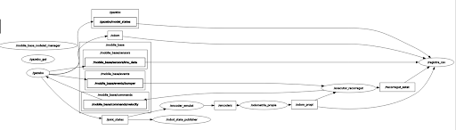
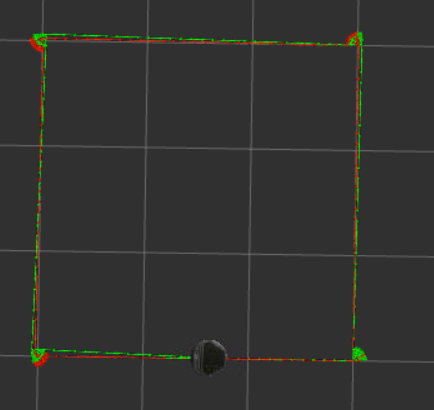
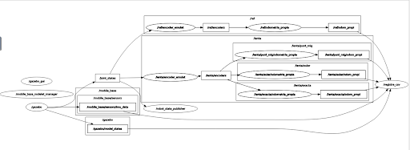
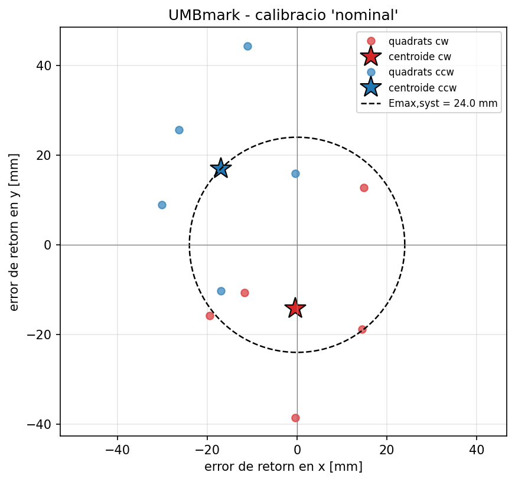
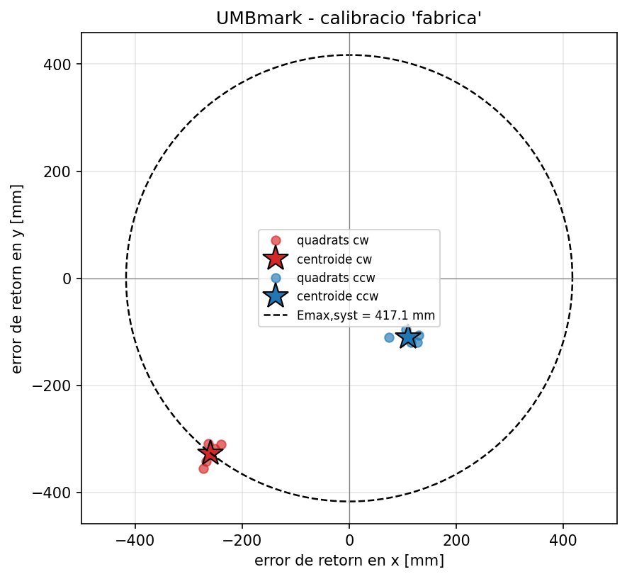
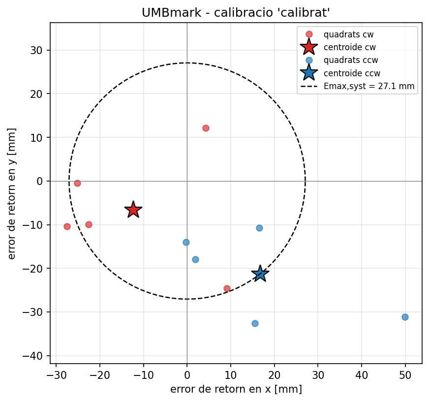
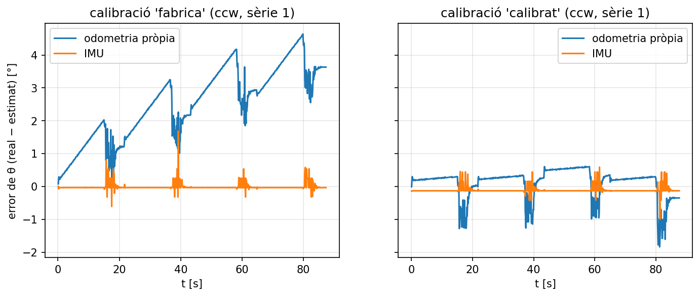

# PL1 — Odometría en robots con ruedas: Kobuki simulado

Ampliación de Robótica (22439) · UIB

Paula Cristina Morro Negre, Toni Oliver Font

---

## 1. Introducción

La odometría estima la pose de un robot a partir de lo que giran sus ruedas. Es barata y se calcula rápido, pero cualquier error pequeño (un radio de rueda ligeramente distinto, una distancia entre ruedas mal medida) se acumula y la pose estimada se va separando de la real.

En esta práctica hemos montado sobre el Kobuki simulado en Gazebo todo el recorrido, desde el contador del encoder hasta una pose calibrada:

| Apartado | Qué hemos hecho |
|---|---|
| 0 | Arrancar el simulador, mover el robot y localizar los topics que se usan después. |
| 1 | Convertir el ángulo de las ruedas en cuentas de encoder de 16 bits y calcular la pose (x, y, θ) a partir de ellas. |
| 2 | Programar un nodo que recorre cuadrados, rectas y arcos guiándose solo por nuestra odometría. |
| 3 | Comparar tres métodos de integración: Euler, punto medio y exacto. |
| 4 | Medir los errores sistemáticos con el método UMBmark, corregir los parámetros y comprobar que la corrección funciona. |

El robot de Gazebo es perfecto, radios de 0,035 m y distancia entre ruedas de 0,230 m. Lo que falla es nuestra odometría, a la que damos unos parámetros de fábrica con error. El robot se fía de ellos, dando errores como no cerrar el cuadrado, y el UMBmark nos sirve para deducir cuánto se equivoca.

---

## 2. Cómo ejecutarlo

```bash
# apartado 1 (con kbuki_sim y kobuki_keyop en marcha)
# probar encoder_emulat.py
rosrun pl1_cognom encoder_emulat.py
rostopic echo /encoders
#probar odometria_propia.py
roslaunch pl1_cognom odometria.launch rviz:=true

# apartado 2
roslaunch pl1_cognom prova.launch                          

# apartado 3
# 5 Hz
roslaunch pl1_cognom integracio.launch
python3 analisi/integracio.py 5
# 2 Hz
roslaunch pl1_cognom integracio.launch freq:=2
python3 analisi/integracio.py 2
# 4 Hz
roslaunch pl1_cognom integracio.launch freq:=4
python3 analisi/integracio.py 4

# apartado 4
# error de fondo (calibración nominal)
roslaunch pl1_cognom umbmark.launch calibracio:=nominal sentit:=cw
roslaunch pl1_cognom umbmark.launch calibracio:=nominal sentit:=ccw
# UMBmark sin calibrar (parámetros de fábrica)
roslaunch pl1_cognom umbmark.launch calibracio:=fabrica sentit:=cw
roslaunch pl1_cognom umbmark.launch calibracio:=fabrica sentit:=ccw
python3 analisi/umbmark.py fabrica
# validar calibración
roslaunch pl1_cognom umbmark.launch calibracio:=calibrat sentit:=cw
roslaunch pl1_cognom umbmark.launch calibracio:=calibrat sentit:=ccw
python3 analisi/umbmark.py calibrat
# comparación de orientacion con la IMU
python3 analisi/orientacio.py
```

---

## 3. Apartado 0: primeros pasos

Este apartado es guiado, pero deja tres datos que se usan en toda la práctica:

| Dato | Valor |
|---|---|
| Articulaciones de las ruedas en `/joint_states` | `wheel_left_joint`, `wheel_right_joint` |
| Frecuencia de `/joint_states` | 100 Hz |
| Modelo del Kobuki en `/gazebo/model_states` | `mobile_base` |

---

## 4. Apartado 1: encoders y odometría

La odometría se calcula en dos nodos, un emulador que convierte el giro de las ruedas en cuentas de encoder y un integrador que reconstruye la pose a partir de esas cuentas.

### 4.1 Resolución del encoder

El fabricante da 52 cuentas por vuelta del eje del motor y una reducción de 6545/132. Las cuentas por vuelta de rueda son:

```
N = 52 · 6545 / 132 = 2578,33 cuentas/vuelta
```

Coincide con el valor por defecto del enunciado. Para ver si esos 52 cuentas ya incluyen el factor ×4 de la cuadratura, probamos la fórmula `N = 4 · PPR · G` con PPR = 52 y sale 10.313,33, cuatro veces más. Los 52 de la ficha técnica ya incluyen el ×4, así que no hay que volver a multiplicarlos.

Cada cuenta equivale a este avance de la rueda:

```
Δs = 2π · r / N = 2π · 0,035 / 2578,33 ≈ 0,0853 mm/cuenta
```

y en giro a:

```
0,085 mm / 0,230 m ≈ 3,7 · 10⁴ rad ≈ 0,02°
```

Este valor marca la resolución de la odometría,  cualquier desplazamiento de la rueda inferior a 0,085 mm no genera un cambio de cuenta y pasa desapercibido para el sistema.

### 4.2 Nodo `encoder_emulat.py`

Gazebo publica el ángulo acumulado de cada rueda en radianes, continuo y sin saltos, mientras que un Kobuki real entrega cuentas enteras de 16 bits que vuelven a 0 después del 65 535. El emulador convierte un formato en el otro y publica un `kobuki_msgs/SensorState`, el mismo mensaje que daría el Kobuki real, de modo que el nodo de odometría no sabe si trabaja con simulación o con el robot.

Para cada mensaje de `/joint_states`:

1. Compara el `header.stamp` con el de la última publicación y solo publica si ha pasado el periodo `1/freq_publicacio`. Si el tiempo retrocede (reinicio de la simulación) publica igualmente y se resincroniza.
2. Cada rueda se localiza con `msg.name.index(...)`, porque el orden de la lista no es fiable.
3. Calculamos las cuentas con `n = round(φ · N / 2π) + comptador_inicial` y después `n % 65536`. En Python el módulo de un negativo siempre sale entre 0 y 65 535, así que también funciona marcha atrás.
4. Publicación con el `stamp` del `/joint_states` original, para que todo el sistema comparta el mismo reloj.

Para probarlo miramos `/encoders` con `rostopic echo`. Al avanzar los dos contadores crecen, y en un giro en el sitio uno crece y el otro decrece. Lanzándolo con `_comptador_inicial:=65000` comprobamos que los contadores pasan de 65 535 a 0 sin problemas.

### 4.3 Nodo `odometria_propia.py`

Cada mensaje de encoders hace un paso completo de odometría, siempre en este orden:

```
cuentas -> Δn (corrige desbordamiento) -> ΔsR, ΔsL -> Δs, Δθ -> integración -> publicar
```

1. La prrimera lectura solo guarda las cuentas y el `stamp`. No integra porque todavía no hay lectura anterior.
2. Δt sale de la diferencia de `header.stamp`, nunca de `rospy.Time.now()`, para que funcione con el tiempo de simulación. Si Δt ≤ 0 se avisa con `logwarn`, se vuelve al estado de primera lectura y se conserva la pose.
3. Si la diferencia entre dos lecturas es menor que −32 768 se suma 65 536, y si es mayor que 32 767 se resta 65 536. Así el salto de 65 535 a 0 se interpreta como +1 y no como un retroceso enorme.
4. Distancia de cada rueda con su propio radio, para poder calibrarlos por separado: `Δs_rueda = r_rueda · 2π · Δn / N`.
5. Modelo diferencial: `Δs = (ΔsR + ΔsL) / 2` y `Δθ = (ΔsR − ΔsL) / b`.
6. Integración con el método de `~metode` y normalización de θ a [−π, π] tras cada paso.
7. Publicación de `odom_propi` (`nav_msgs/Odometry`) con `frame_id = odom_propi` y `child_frame_id = base_footprint_propi`, la transformada tf si `~publicar_tf` es cierto, y las velocidades `v = Δs/Δt`, `ω = Δθ/Δt`. No usamos `odom` ni `base_footprint`, porque ya los publica el simulador.

Decisiones de diseño:

- Los quaterniones solo aparecen en la frontera con ROS. Dentro del código la pose es siempre (x, y, θ) en radianes. Se convierte a quaternión con `quaternion_from_euler` al publicar, y el executor lo vuelve a pasar a θ con `euler_from_quaternion` al leer. Así no hacemos nunca cuentas con componentes de quaterniones.
- Un `threading.Lock` protege el estado, porque el callback de los encoders y el servicio `~reset` corren en hilos distintos.
- El servicio `~reset` pone x, y, θ a cero pero conserva los últimos recuentos leídos. Si no lo hiciera, el paso siguiente vería un salto enorme en las cuentas y la pose saltaría.
- Los parámetros se leen todos con `rospy.get_param` y se cargan desde `kobuki_<calibracio>.yaml`. En el código solo quedan los valores por defecto.
- Publicamos una matriz de covarianza diagonal constante: $10^{-3}\ \text{m}^2$ en $x$ e $y$, $10^{-2}\ \text{rad}^2$ en yaw, y $10^{6}$ en las componentes que no se estiman ($z$, roll y pitch, al tratarse de un robot plano). El valor de $10^{-3}\ \text{m}^2$ equivale a una desviación típica de unos $3\text{ cm}$, un margen algo conservador frente a la dispersión de $1$ a $2\text{ cm}$ por eje medida después en el UMBmark con parámetros nominales (ver apartado 7.3). Al ser una estimación fija, no aumenta con la distancia recorrida, aunque en la realidad la incertidumbre de la odometría sí crece conforme avanza el robot.

Para validar se comparó `/odom_propi` con `/odom` en `rqt_plot` en recta, giro en sitio y curva, se comprobó que `base_footprint_propi` sigue al robot en rviz, que con `comptador_inicial:=65000` no hay saltos, y que tras `rosservice call /odometria_propia/reset` la pose vuelve a cero sin saltos.  La Figura 1 muestra la cadena completa durante la prueba del apartado 3.



### 4.4 Dificultades y soluciones

Lo más delicado fue entender cuándo sumar o restar 65536. El contador salta de 65535 a 0 aunque la rueda haya avanzado unas pocas cuentas, y la diferencia directa sale enorme. Como un incremento real entre dos mensajes nunca llega a la mitad del rango, un salto mayor que 32767 en valor absoluto es un desbordamiento. Se probó arrancando el contador cerca del límite.

Usar Time.now() daría Δt erróneos al pausar o reiniciar Gazebo. Se usa el stamp de los mensajes, y un Δt ≤ 0 reinicia la lectura sin perder la pose.

 Los launch del enunciado usan pl1_cognom, y los comandos con otro nombre de paquete no funcionaban. Se resolvió comprobándolo con rospack find y revisando con grep los launch.

## 5. Apartado 2: executor de recorridos

El UMBmark necesita repetir muchas veces el mismo cuadrado, en los dos sentidos, guiado solo por la odometría del propio robot. El nodo `executor_recorregut.py` lo hace con un control proporcional y publica las velocidades en `/mobile_base/comands/velocity`.

### 5.1 Segmentos

Un recorrido es una lista de segmentos de tres tipos:

| Segmento | Qué hace | Cuándo termina |
|---|---|---|
| Tramo recto  | Avanza a `v_max` y corrige el rumbo con `ω = kp · e`, donde e es la diferencia normalizada entre el rumbo del inicio del tramo y el actual | Cuando la distancia euclídea desde el inicio llega a `d − tol_dist` |
| Giro en el sitio  | `v = 0` y `ω = kp · e` saturada a ±`w_max`, con `e = rumbo_objetivo − rumbo_actual` | Cuando `abs(e) < tol_angle` |
| Arco abierto | `v = v_max` y `ω = v_max / radi_arc`, constantes | Cuando el rumbo acumulado llega al ángulo pedido |

- El arco va en lazo abierto. Si le aplicáramos el control de rumbo, el controlador enderezaría el robot y perderíamos justo la curvatura que queremos medir.
- En el arco se acumulan incrementos pequeños de rumbo en lugar de comparar con un rumbo final. A partir de 180° la comparación directa es ambigua, porque +180° y −180° son el mismo ángulo.
- Entre segmentos el robot se para y espera medio segundo.

### 5.2 Secuencias según `~tipus` y `~sentit`

- `quadrat` + `ccw`: cuatro veces [tramo de `costat` m, giro de +90°], a la izquierda.
- `quadrat` + `cw`: cuatro veces [tramo de `costat` m, giro de −90°], a la derecha.
- `recta`: un único tramo de `longitud_recta` m.
- `arc`: un único arco de `angle_arc` grados, positivo en `ccw` y negativo en `cw`.

El sentido se resume en un signo (+1 antihorario, −1 horario), de modo que el mismo código sirve para los dos.

### 5.3 Ciclo de repeticiones

Para cada repetición n = 1 … `repeticions`:

1. Devuelve el robot a `pose_inicial` con `/gazebo/set_model_state` (velocidades a cero) y espera `pausa` segundos.
2. Llama a los servicios de `serveis_reset` para poner a cero la odometría.
3. Espera a recibir una odometría nueva, con un máximo de 2 s. Sin este paso, x, y, θ podrían conservar los valores de antes del reset y el primer tramo calcularía mal su punto de partida.
4. Publica `inici <n>` en `/recorregut_estat`, ejecuta los segmentos, para el robot, espera `pausa` y publica `fi <n>`.

Al terminar todas las repeticiones el nodo se apaga con `rospy.signal_shutdown`.

### 5.4 Seguridad y reglas respetadas

- Si llega un `BumperEvent` con `state = 1`, se activa una bandera de emergencia, se para el robot, se registra un `logerr` y el nodo finaliza. Hace falta la bandera porque `signal_shutdown` no es instantáneo y los bucles de control seguirían ejecutándose unos ciclos más.
- Con `rospy.on_shutdown(self.aturar)` el robot recibe siempre velocidad cero al cerrar el nodo.
- El control usa únicamente `odom_propi`. No se lee `/odom` ni `/gazebo/model_states`, así el UMBmark mide el error de un robot que se fía de su propia odometría.

### 5.5 Prueba

Con `roslaunch pl1_cognom prova.launch` el robot hace dos cuadrados de 3 m en sentido antihorario, volviendo al origen entre ambos, y en `resultats/prova/` aparecen `finals.csv`, `serie_1.csv` y `serie_2.csv`. Con parámetros nominales, tras cada cuadrado el robot real queda a 10,2 cm y a 4,5 cm del punto de partida, y la odometría propia a 7,3 cm y 1,3 cm de la pose real. La Figura 2 muestra el recorrido en rviz, con la odometría propia (rojo) y la de Gazebo (verde).



### 5.6 Dificultades y soluciones

Para medir el arco no se puede cerrar por distancia ni con control de rumbo, se hace en lazo abierto y se cierra por el ángulo acumulado, sumando incrementos.

Con un bumper pulsado el nodo no se detiene al instante, y por eso se usa una bandera de emergencia.

Con el Fixed Frame odom de Gazebo, rviz no dibujaba `/odom_propi` (error de transformación: el frame odom_propi no está conectado a odom). Como los dos arrancan en el origen, para las capturas se publicó una transformación fija con static_transform_publisher 0 0 0 0 0 0 odom odom_propi.

## 6. Apartado 3: métodos de integración

### 6.1 Los tres métodos

Los tres reciben la pose anterior (x, y, θ) y los incrementos Δs y Δθ, y devuelven la pose nueva:

| Método | Idea | Fórmula para (x, y) |
|---|---|---|
| Euler | Avanza Δs con la orientación del inicio del paso y luego gira | `x += Δs·cos θ`, `y += Δs·sin θ` |
| Punto medio | Avanza Δs con la orientación media del paso | `φ = θ + Δθ/2`; `x += Δs·cos φ`, `y += Δs·sin φ` |
| Exacta | Avanza la cuerda del arco con la orientación media | `c = 2·(Δs/Δθ)·sin(Δθ/2)  |

En el método exacto, si `|Δθ| < llindar_dtheta` ($10^{-6}\text{ rad}$) consideramos que el robot va prácticamente recto y tomamos la cuerda como c = Δs, lo que equivale a aplicar el método del punto medio. Así se evita dividir por un Δθ casi nulo.

La diferencia entre métodos solo se aprecia en trayectorias curvas. En un tramo recto (Δθ = 0) y en un giro en el sitio (Δs = 0) las tres fórmulas producen exactamente el mismo resultado. Por eso el experimento usa un arco de 180°, que es además el ángulo en el que más se separan los métodos.

### 6.2 Experimento

`integracio.launch` ejecuta simultáneamente cuatro odometrías sobre el mismo robot, una odometría de referencia (`/ref`, con método exacto y un emulador por encima de los 100 Hz de `/joint_states`, para que no submuestree) y tres a baja frecuencia (Euler, punto medio y exacta) que reciben exactamente las mismas cuentas de un segundo emulador. Como las cuatro siguen al mismo robot, el deslizamiento real de las ruedas les afecta por igual y, al restar la referencia, queda solo el error que añade el método de integración. Además, las cuatro cargan `kobuki_nominal.yaml` para no introducir errores sistemáticos en la prueba.

`analisi/integracio.py <freq>` calcula, para cada método, el error de posición final respecto a la referencia:

```
error = sqrt((x − x_ref)² + (y − y_ref)²)
```

y guarda la tabla en `resultats/integracio_taula_<freq>.csv`.



### 6.3 Resultados

Al doblar la frecuencia de 2 Hz a 4 Hz, la teoría dice que el error de Euler se divide por 2, el del punto medio por 4 y el de la exacta no cambia:

| Método | Error a 2 Hz (mm) | Error a 4 Hz (mm) | Cociente |
|---|---|---|---|
| Euler | 100,24 | 50,38 | 1,99 (esperado ≈ 2) |
| Punto medio | 1,63 | 0,37 | 4,37 (esperado ≈ 4) |
| Exacta | 0,05 | 0,08 | no aplica |

Ordenados de mayor a menor error: Euler, punto medio y exacta, que es el orden esperado. Los cocientes se parecen a lo que predice la teoría, Euler (1,99) se acerca a 2, porque su error es de primer orden y se divide por 2 al doblar la frecuencia. El punto medio (4,37) se acerca a 4, porque su error es de segundo orden. La pequeña desviación del 4,37 es normal con un solo recorrido por frecuencia y con errores tan pequeños, cercanos a la resolución del encoder (0,085 mm). La exacta no tiene cociente, su error es tan pequeño, del orden de la resolución del encoder, que no sigue ninguna tendencia.

Nuestro nodo usa `punt_mig` por defecto. Es sencillo de programar, no tiene el problema de dividir por Δθ ≈ 0 que tiene la exacta, y a las frecuencias a las que trabaja el robot (50 a 100 Hz) la diferencia con la exacta es mínima. A 4 Hz el punto medio ya tiene un error de 0,37 mm, y a 50–100 Hz sería mucho menor, por lo que la diferencia con la exacta es despreciable.

### 6.4 Dificultades y soluciones

Comparar con la pose de Gazebo mezclaría el error de integración con la cuantización de los encoders y el deslizamiento. Se usa una referencia propia, con las mismas cuentas a alta frecuencia, para que la diferencia sea solo de integración.

## 7. Apartado 4: UMBmark y calibración

### 7.1 Método

Es un método de Borenstein y Feng (1996) para medir los errores sistemáticos de la odometría. El robot recorre varias veces un cuadrado en sentido horario (`cw`) y antihorario (`ccw`). En cada recorrido se mide el error de retorno `e = real − estimado` y se calcula el centro de gravedad de los errores de cada sentido.

Distingue dos errores sistemáticos:

- Ed: relación entre los diámetros de las ruedas. Hace que el robot se curve cuando debería ir recto.
- Eb: relación entre la distancia real entre ruedas y la que se cree la odometría. Hace que los giros no sean exactamente de 90°.

```
α = ( xcw + xccw ) / (−4L) · 180/π        
β = ( xcw − xccw ) / (−4L) · 180/π
R = (L/2) / sen(β/2)        
Ed = ( R + b/2 ) / ( R − b/2 )        
Eb = 90° / ( 90° − α )
```
   
Se combinan los dos sentidos porque Eb desplaza los dos centroides en la misma dirección (α sale de la suma de sus x) y Ed en direcciones opuestas (β sale de la diferencia). Con un solo sentido los dos errores quedarían mezclados. Emax,syst es el mayor de los dos radios de los centroides.

### 7.2 Resultado esperado y error de fondo

Comparando `kobuki_fabrica.yaml` con `kobuki_nominal.yaml`:
 
| Parámetro | Lo que cree la odometría (fábrica) | Real (nominal) |
|---|---|---|
| `radi_dreta` | 0,0349563 m | 0,035 m |
| `radi_esquerra` | 0,0350437 m | 0,035 m |
| `distancia_rodes` | 0,2284693 m | 0,230 m |

Con estos parámetros se puede calcular a mano lo que debería medir el UMBmark::

```
Ed esperado = (razón real de ruedas) / (razón que se cree) = 1 / (0,0349563 / 0,0350437) ≈ 1,0025
Eb esperado = b_real / b_creído = 0,230 / 0,2284693 ≈ 1,0067
```

Antes de usar los parámetros de fábrica ejecutamos el UMBmark con los nominales. Lo que queda es el error del propio executor, que sirve de referencia (error de fondo). Cada giro termina cuando `|e| < tol_angle` (0,002 rad ≈ 0,11°). Como el control proporcional se acerca al objetivo por un lado, el robot se queda siempre algo corto, y el UMBmark lo interpreta como un Eb. Por eso con calibración nominal sale α = +0,083° (por debajo de la tolerancia) y Eb = 1,0009 en vez de 1.

### 7.3 Resultados

| Calibración | Ed | Eb | α (°) | β (°) | Emax,syst |
|---|---|---|---|---|---|
| Nominal (error de fondo) | 0,99989 | 1,00093 | +0,083 | −0,079 | 24,0 mm |
| Fábrica (sin calibrar) | 1,00235 | 1,00793 | +0,708 | +1,764 | 417,1 mm |
| Calibrado | 1,00019 | 0,99977 | −0,021 | +0,139 | 27,1 mm |

Comparación con fábrica:

| | Esperado  | Medido con fábrica | Diferencia |
|---|---|---|---|
| Ed | 1,0025 | 1,0023 | 0,0002 |
| Eb | 1,0067 | 1,0079 | 0,0012 |

Lo medido coincide con lo calculado. La diferencia en Eb es del orden del error de fondo (0,0009): 1,0067 + 0,0009 = 1,0076, a solo 0,0003 de lo medido.





Con parámetros de fábrica los recorridos de cada sentido quedan agrupados (dispersión de 1 a 2 cm) pero lejos del origen. El centroide `cw` está en (−259, −327) mm y el `ccw` en (+111, −110) mm. Esto indica que el error es sistemático, se repite siempre igual, y por eso se puede calibrar.



Tras calibrar, Emax,syst baja de 417 mm a 27 mm (≈ 93 % menos), del mismo orden que el error de fondo (24 mm). Con solo cinco recorridos por sentido y 1 a 2 cm de dispersión, la diferencia entre 24 y 27 mm no es significativa. Hemos llegado al límite que permite el executor.

### 7.4 Funciones completadas en `analisi/umbmark.py`

| Función | Qué calcula |
|---|---|
| `centre_gravetat(ex, ey)` | Media de los errores de retorno de un sentido |
| `emax_syst(cg_cw, cg_ccw)` | `r_cw`, `r_ccw` (distancia de cada centroide al origen) y `Emax,syst = max(r_cw, r_ccw)` |
| `alfa_beta(cg_cw, cg_ccw, L)` | `α = (x_cw + x_ccw) / (−4L)` y `β = (x_cw − x_ccw) / (−4L)`, pasados a grados |
| `factors(α, β, L, b)` | `R = (L/2) / sin(β/2)`, `Ed = (R + b/2) / (R − b/2)` y `Eb = 90 / (90 − α)`. β se pasa a radianes antes del seno y se evita dividir por cero si β = 0 |
| `parametres_corregits(Ed, Eb, params)` | Valores nuevos de `radi_dreta`, `radi_esquerra` y `distancia_rodes` |

El punto delicado está en `parametres_corregits`. La fórmula de la diapositiva (`DR/DL = Ed`) supone que la odometría parte de dos ruedas iguales. En nuestro caso parte de los valores de fábrica, que ya tienen una razón equivocada, y lo que mide el UMBmark es la discrepancia respecto a lo que se creía. Por eso Ed multiplica la razón que ya se usaba:

```
Ed_total = (radi_dreta / radi_esquerra) · Ed
b_nou = Eb · distancia_rodes
```

Si se asignara `DR/DL = Ed` directamente, la corrección no corregiría el error, le cambiaría el signo.

Resultado en `config/kobuki_calibrat.yaml`, generado automáticamente por `umbmark.py fabrica`:

| Parámetro | Fábrica | Calibrado | Real |
|---|---|---|---|
| `radi_dreta` | 0,0349563 | 0,0349973 | 0,035 |
| `radi_esquerra` | 0,0350437 | 0,0350027 | 0,035 |
| `distancia_rodes` | 0,2284693 | 0,2302799 | 0,230 |

Tras la calibración los dos radios quedan casi iguales (razón 0,99985) y la distancia entre las ruedas (b) queda a un 0,12 % del valor real. Ese residuo es del mismo orden que el error de fondo de `tol_angle` que el UMBmark absorbe dentro de Eb.

### 7.5 Orientación: odometría frente a IMU

`analisi/orientacio.py` dibuja el error de θ (`theta_real − theta_estimada`) a lo largo del primer recorrido `ccw`, para nuestra odometría y para la IMU.



| Calibración | Fuente | Error final | Error máximo |
|---|---|---|---|
| Fábrica | Odometría propia | +3,63° | 4,64° |
| Fábrica | IMU | −0,04° | 1,69° |
| Calibrado | Odometría propia | −0,35° | 1,84° |
| Calibrado | IMU | −0,13° | 0,99° |

Con los parámetros de fábrica falla la odometría, no la IMU. En la gráfica de fábrica el error de la odometría sube en rampa durante cada tramo recto y baja de golpe al hacer cada giro, y estos dos efectos tienen causas distintas:

- La rampa viene de Ed. La odometría cree que una rueda es algo más grande que la otra y se corrige para ir recta, de modo que el robot real se va curvando. Con Ed = 1,0025 en un tramo de 3 m produce una desviación angular de `0,0025 · 3 / 0,23 ≈ 0,033 rad ≈ 1,9°`, y en la figura cada rampa sube alrededor de 2°.
- El escalón en cada giro viene de Eb. Con una b creída demasiado pequeña, la odometría piensa que ha girado más de lo que giró en realidad, y el robot real se queda corto. Cada escalón es de en torno a 1°, del orden de lo que se espera con un Eb de 1,0067 (0,6° por cada giro de 90°).

Los dos efectos van en sentidos contrarios, por eso el error no se dispara y termina en 3,6°. Esto también explica que en los recorridos `cw` el error de orientación sea mucho mayor (entre 10° y 11° al final, según `finals.csv`) que en `ccw` (entre 3,6° y 5°), en un sentido Ed y Eb se compensan en parte y en el otro se suman.

La IMU mide el giro real con su giroscopio, sin usar los radios ni b, así que los parámetros erróneos no le afectan y su error se mantiene cerca de cero. Los picos que aparecen durante los giros se ven en las dos fuentes, y también con los parámetros calibrados, de modo que no son un error sistemático sino un efecto del muestreo. Los datos se registran a 10 Hz mientras el robot gira a unos 29°/s, y una diferencia de décimas de segundo entre la pose real y la estimada basta para dar un error de varios grados.

Con los parámetros calibrados el error de la odometría baja de 2° en todo el recorrido y deja de crecer en rampa.

Esto enlaza con la fusión de sensores. La odometría da posición con buena resolución pero acumula error, y la IMU da una orientación independiente de las ruedas pero no da posición. Un filtro puede combinar las dos fuentes y compensar los puntos débiles de cada una. 

### 7.6 Dificultades y soluciones

La fórmula de la diapositiva (DR/DL = Ed) supone que la odometría parte de dos ruedas iguales. Aquí parte de los valores de fábrica, que ya tienen una razón equivocada, y el UMBmark mide la discrepancia respecto a lo que se creía. Por eso se hacen las operaciones del apartado 7.4

`tol_angle` se confunde con Eb, y por eso conviene mantenerla pequeña y medir primero el UMBmark con parámetros correctos.

## 8. Dificultades generales del entorno

Tras cerrar un launch de golpe, el siguiente mostraba cientos de líneas «Connection refused» y rqt_graph no encontraba el master. Se solucionó con pkill -f ros, pkill gzserver y pkill gzclient, y lanzando de nuevo.

El TF mostraba todos los ejes con etiquetas, las flechas de odometría medían 1 m y la covarianza de /odom (0,1) dibujaba un círculo enorme. Se desactivaron el TF y la covarianza y se redujeron las flechas.

## 9. Conclusiones

1. La odometría funciona, pero los errores se acumulan. Con unos parámetros de fábrica con un error de solo el 0,25 % entre los radios y el 0,7 % en b, el robot termina a más de 40 cm del punto de partida tras un cuadrado de 3 m.
2. El UMBmark identifica bien los errores sistemáticos. Los Ed y Eb medidos (1,0023 y 1,0079) coinciden con los calculados (1,0025 y 1,0067, más el error de fondo).
3. La calibración funciona, Emax,syst baja de 417 mm a 27 mm (alrededor de un 93 % menos) y queda al nivel del error de fondo del executor.
4. Hay un límite que la calibración no puede superar. El error de fondo, 24 mm con parámetros correctos, viene del executor y de los errores no sistemáticos. La tolerancia de los giros (`tol_angle`) se confunde con Eb y por eso conviene mantenerla pequeña.
5. La IMU complementa a la odometría. Con parámetros erróneos, la orientación calculada con las ruedas se desvía varios grados y la de la IMU no, lo que justifica fusionar ambas fuentes.
